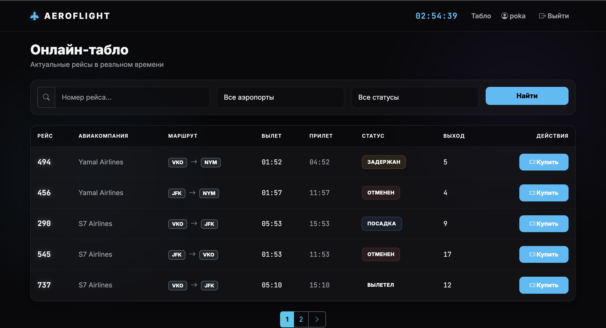
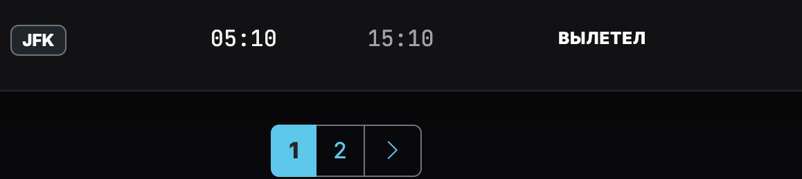
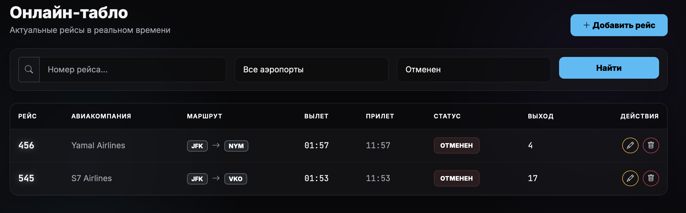
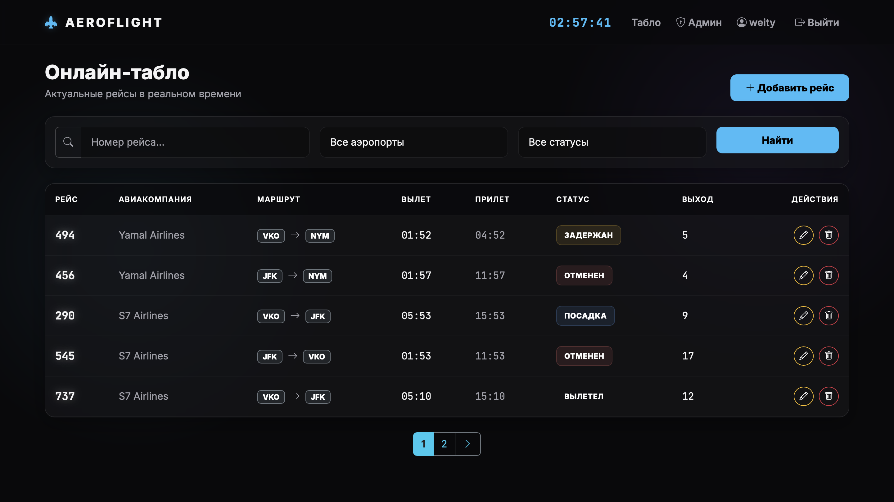
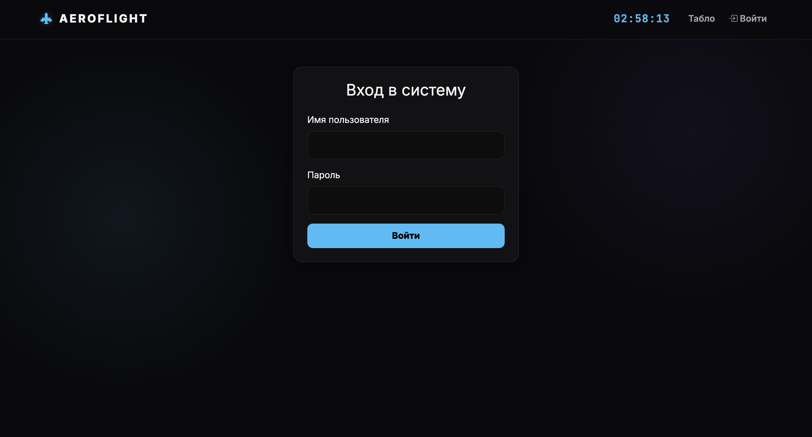

# Реализованные интерфейсы и логика

## 1. Главная страница (Табло перелетов)
Главная страница отображает список всех рейсов. Реализована стилизация под современное табло аэропорта (темная тема, шрифты `JetBrains Mono` для времени). 
В шапке сайта работают **живые часы**.

## 2. Пагинация
Для удобства просмотра реализована пагинация (`paginate_by = 5`). Внизу страницы отображаются кнопки переключения страниц.

## 3. Поиск и фильтрация
Реализован поиск по номеру рейса, а также фильтрация по аэропорту вылета и текущему статусу рейса.

## 4. Разграничение прав (Клиентский интерфейс)
С помощью проверки `` реализовано разделение интерфейса:
*   **Администратор** видит кнопки добавления, редактирования и удаления рейсов.
*   **Обычный пользователь** видит только кнопку «Купить», а кнопки управления скрыты.

**Вид от Администратора:**

**Вид от Обычного пользователя:**

## 5. Авторизация и регистрация
Реализована стилизованная страница входа в систему.
