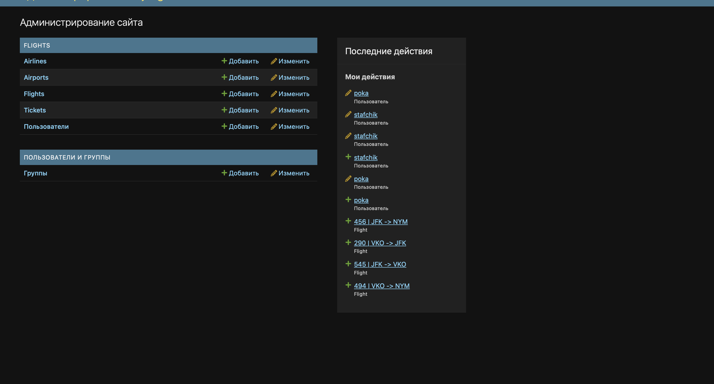

# Модели данных

В файле `models.py` приложения `flights` реализованы следующие модели:

### 1. User (Пользователь)
Кастомная модель пользователя, унаследованная от `AbstractUser`. Добавлены дополнительные поля (по заданию ЛР3).
*   `passport_number` — номер паспорта.
*   `phone` — телефон.

### 2. Airline (Авиакомпания)
*   `name` — название.
*   `code` — код IATA.

### 3. Airport (Аэропорт)
*   `name` — название аэропорта.
*   `city` — город.
*   `code` — код IATA.

### 4. Flight (Рейс)
*   `flight_number` — номер рейса.
*   `airline` — внешний ключ (FK) на авиакомпанию.
*   `departure_airport` — FK на аэропорт вылета.
*   `arrival_airport` — FK на аэропорт прилета.
*   `departure_time` / `arrival_time` — дата и время.
*   `status` — статус рейса (поле с выбором `choices`: по расписанию, задержан, отменен, посадка).
*   `gate` — выход (Gate).

### 5. Ticket (Билет)
*   `flight` — FK на рейс.
*   `passenger` — FK на пользователя.
*   `seat_number` — номер места.

**Схема базы данных:**
