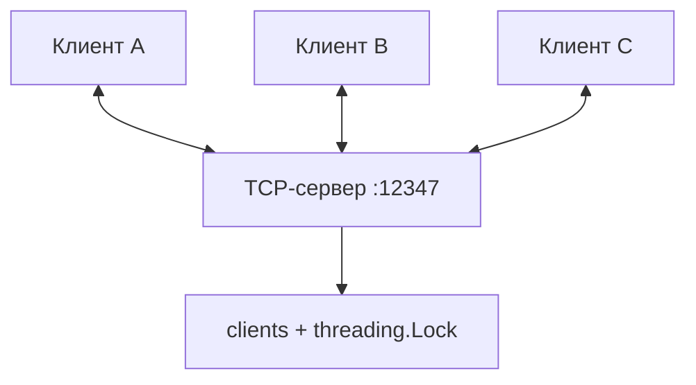
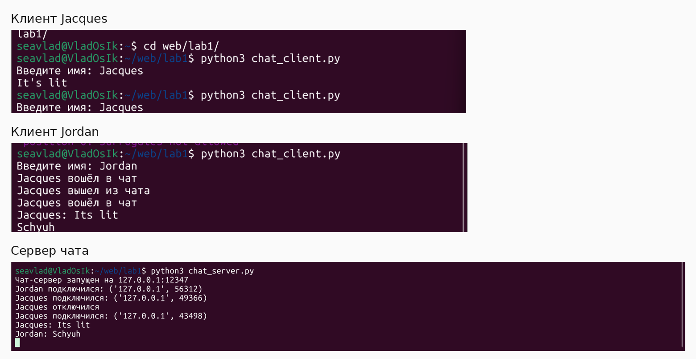

# 04 · Многопользовательский TCP-чат

`threading` · Порт `12347` · Несколько клиентов одновременно

## Постановка задачи

Реализовать чат, в котором несколько клиентов могут подключиться к одному серверу и отправлять сообщения другим участникам. Каждый клиент указывает имя при входе, а команда `/exit` завершает его сессию.

## Архитектура

Сервер принимает новые TCP-соединения в главном потоке. Для каждого клиента создаётся отдельный `threading.Thread`, который читает его сообщения. Общий словарь `clients` сопоставляет клиентские сокеты с именами, а `threading.Lock` защищает операции над словарём.



### Сценарий обмена

1. При подключении клиент передаёт своё имя с символом перевода строки.
2. Сервер регистрирует соединение и сообщает другим участникам о входе.
3. Клиент отправляет текст; сервер вызывает `broadcast()` и пересылает его **всем остальным** участникам.
4. Клиент читает входящие сообщения в отдельном фоновом потоке, поэтому может одновременно вводить новые.
5. При `/exit` либо разрыве соединения сервер удаляет клиента из общего словаря.

!!! tip "Почему используется `Lock`?"
    Несколько обработчиков изменяют общий словарь. Блокировка делает операции регистрации, удаления и копирования списка получателей согласованными. Сетевые отправки происходят уже после освобождения блокировки, поэтому медленный получатель не удерживает её во время `sendall()`.

## Исходный код

=== "Сервер · chat_server.py"

    ```python
    import socket
    import threading
    
    HOST = "127.0.0.1"
    PORT = 12347
    
    clients = {}
    lock = threading.Lock()
    
    
    def broadcast(message, sender=None):
        with lock:
            recipients = [
                client for client in clients
                if client != sender
            ]
    
        for client in recipients:
            try:
                client.sendall((message + "\n").encode())
            except OSError:
                pass
    
    
    def handle_client(conn, address):
        name = None
    
        try:
            with conn:
                reader = conn.makefile("r", encoding="utf-8")
                name = reader.readline().strip()
    
                if not name:
                    return
    
                with lock:
                    clients[conn] = name
    
                print(f"{name} подключился: {address}")
                broadcast(f"{name} вошёл в чат", conn)
    
                for line in reader:
                    message = line.strip()
    
                    if message == "/exit":
                        break
    
                    if message:
                        print(f"{name}: {message}")
                        broadcast(f"{name}: {message}", conn)
    
        except (OSError, UnicodeError):
            pass
    
        finally:
            with lock:
                clients.pop(conn, None)
    
            if name:
                print(f"{name} отключился")
                broadcast(f"{name} вышел из чата")
    
    
    server = socket.socket(socket.AF_INET, socket.SOCK_STREAM)
    server.setsockopt(socket.SOL_SOCKET, socket.SO_REUSEADDR, 1)
    server.bind((HOST, PORT))
    server.listen()
    
    print(f"Чат-сервер запущен на {HOST}:{PORT}")
    
    while True:
        conn, address = server.accept()
    
        thread = threading.Thread(
            target=handle_client,
            args=(conn, address),
            daemon=True
        )
        thread.start()
    ```

=== "Клиент · chat_client.py"

    ```python
    import socket
    import threading
    
    HOST = "127.0.0.1"
    PORT = 12347
    
    client = socket.socket(socket.AF_INET, socket.SOCK_STREAM)
    client.connect((HOST, PORT))
    
    name = input("Введите имя: ")
    client.sendall((name + "\n").encode())
    
    
    def receive_messages():
        while True:
            try:
                data = client.recv(1024)
    
                if not data:
                    break
    
                print(data.decode(), end="", flush=True)
    
            except OSError:
                break
    
    
    threading.Thread(target=receive_messages, daemon=True).start()
    
    try:
        while True:
            message = input()
    
            client.sendall((message + "\n").encode())
    
            if message == "/exit":
                break
    
    except (KeyboardInterrupt, EOFError, OSError, UnicodeError):
        pass
    
    finally:
        client.close()
    ```

## Запуск

Откройте три терминала в каталоге `task_4`.

```bash
# Терминал 1
python3 chat_server.py
```

```bash
# Терминалы 2 и 3 — каждый в своём окне
python3 chat_client.py
```

Введите разные имена и отправьте сообщения. Проверьте, что сообщение клиента A появляется у B и наоборот. Командой `/exit` можно выйти из чата.

## Результат



<p class="result-caption">Рисунок 5. Два участника чата и журнал событий сервера.</p>

## Особенности и ограничения

- Каждому подключению соответствует отдельный поток сервера.
- Сообщения разделяются символом `\n`.
- Сервер не отправляет автору его собственное сообщение обратно.
- История сообщений не сохраняется, повторяющиеся имена не запрещены, аутентификации нет.
- `recv(1024)` у клиента может вернуть часть сообщения или сразу несколько; для надёжного построчного отображения в промышленном приложении потребовался бы буфер строк.

**Вывод:** в работе продемонстрировано одновременное обслуживание нескольких TCP-соединений и синхронизация общего состояния между потоками.
