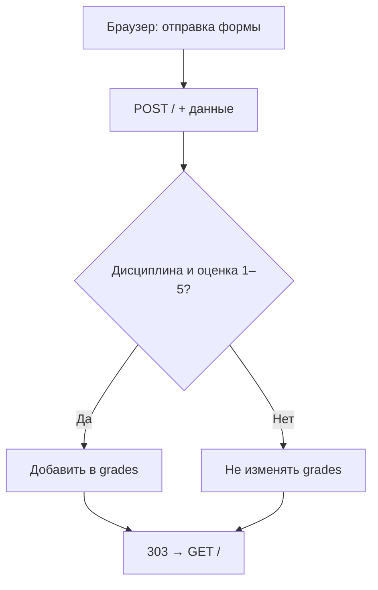
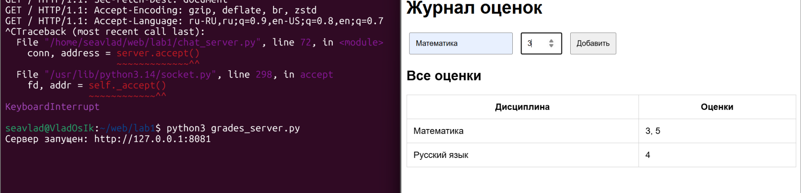

# 05 · Журнал оценок по HTTP

`GET /` · `POST /` · Порт `8081` · HTML-форма

## Постановка задачи

Реализовать веб-страницу журнала оценок, на которой можно видеть дисциплины и добавленные оценки, а также вводить новые оценки через HTML-форму. HTTP-запросы должны обрабатываться собственным TCP-сервером.

## Данные и маршрут

Программа хранит оценки в словаре `grades`, где ключ — название дисциплины, а значение — список целых чисел от 1 до 5.

```python
grades = {
    "Математика": [5, 4],
    "Русский язык": [5],
}
```

Этот фрагмент **иллюстрирует формат данных**, а не начальное содержимое словаря: в исходной программе `grades = {}`.

| Запрос | Действие сервера | Ответ |
|---|---|---|
| `GET /` | Генерация HTML-таблицы и формы | `200 OK`, HTML |
| `POST /` | Чтение формы, проверка и возможное добавление оценки | `303 See Other`, `Location: /` |
| Другой метод или путь | Отказ от обработки | `404 Not Found` |

## Обработка формы



1. Сервер считывает HTTP-заголовки до разделителя `\r\n\r\n`.
2. По `Content-Length` получает тело `POST` в полном объёме.
3. `parse_qs()` разбирает данные формы.
4. Пустое название дисциплины и оценки вне диапазона 1–5 не добавляются.
5. Ответ `303 See Other` перенаправляет браузер на `GET /`, чтобы обновить таблицу.
6. `html.escape()` экранирует название дисциплины перед подстановкой в HTML.

## Исходный код

```python
import socket
from html import escape
from urllib.parse import parse_qs

HOST = "127.0.0.1"
PORT = 8081

grades = {}


def make_page():
    rows = ""

    for subject, marks in grades.items():
        rows += (
            f"<tr><td>{escape(subject)}</td>"
            f"<td>{', '.join(map(str, marks))}</td></tr>"
        )

    return f"""<!DOCTYPE html>
<html lang="ru">
<head>
    <meta charset="UTF-8">
    <title>Журнал оценок</title>
    <style>
        body {{ font-family: Arial; max-width: 700px;
                margin: 50px auto; }}
        input, button {{ padding: 10px; margin: 5px; }}
        table {{ width: 100%; border-collapse: collapse; }}
        th, td {{ border: 1px solid #ccc; padding: 12px; }}
    </style>
</head>
<body>
    <h1>Журнал оценок</h1>

    <form method="POST" action="/">
        <input name="subject" placeholder="Дисциплина" required>
        <input name="grade" type="number" min="1" max="5"
               placeholder="Оценка" required>
        <button type="submit">Добавить</button>
    </form>

    <h2>Все оценки</h2>
    <table>
        <tr><th>Дисциплина</th><th>Оценки</th></tr>
        {rows}
    </table>
</body>
</html>"""


def handle_client(conn):
    with conn:
        request = b""

        while b"\r\n\r\n" not in request:
            chunk = conn.recv(4096)
            if not chunk:
                return
            request += chunk

        header_data, body = request.split(b"\r\n\r\n", 1)
        lines = header_data.decode("iso-8859-1").split("\r\n")
        method, path, _ = lines[0].split()

        headers = {}
        for line in lines[1:]:
            if ":" in line:
                key, value = line.split(":", 1)
                headers[key.lower()] = value.strip()

        if method == "POST" and path == "/":
            length = int(headers.get("content-length", "0"))

            while len(body) < length:
                chunk = conn.recv(4096)
                if not chunk:
                    return
                body += chunk

            form = parse_qs(body[:length].decode("utf-8"))
            subject = form.get("subject", [""])[0].strip()
            grade = form.get("grade", [""])[0]

            if subject and grade.isdigit() and 1 <= int(grade) <= 5:
                grades.setdefault(subject, []).append(int(grade))

            response = (
                "HTTP/1.1 303 See Other\r\n"
                "Location: /\r\n"
                "Content-Length: 0\r\n"
                "Connection: close\r\n\r\n"
            ).encode("utf-8")

        elif method == "GET" and path == "/":
            content = make_page().encode("utf-8")
            response = (
                "HTTP/1.1 200 OK\r\n"
                "Content-Type: text/html; charset=utf-8\r\n"
                f"Content-Length: {len(content)}\r\n"
                "Connection: close\r\n\r\n"
            ).encode("utf-8") + content

        else:
            content = b"Not Found"
            response = (
                "HTTP/1.1 404 Not Found\r\n"
                "Content-Type: text/plain; charset=utf-8\r\n"
                f"Content-Length: {len(content)}\r\n"
                "Connection: close\r\n\r\n"
            ).encode("utf-8") + content

        conn.sendall(response)


server = socket.socket(socket.AF_INET, socket.SOCK_STREAM)
server.setsockopt(socket.SOL_SOCKET, socket.SO_REUSEADDR, 1)
server.bind((HOST, PORT))
server.listen(5)

print(f"Сервер запущен: http://{HOST}:{PORT}")

try:
    while True:
        conn, address = server.accept()
        handle_client(conn)
except KeyboardInterrupt:
    print("\nСервер остановлен")
finally:
    server.close()
```

## Запуск и проверка

Из каталога `task_5`:

```bash
python3 grades_server.py
```

Откройте **[http://127.0.0.1:8081/](http://127.0.0.1:8081/)**. Введите дисциплину, выберите оценку от 1 до 5 и нажмите «Добавить». После отправки формы страница должна обновиться, показав новую запись.

Проверка через терминал (в отдельном окне):

```bash
curl -i http://127.0.0.1:8081/
curl -i -d "subject=Math&grade=5" http://127.0.0.1:8081/
curl -s http://127.0.0.1:8081/ | grep Math
```

Первая команда должна вернуть статус `200`, вторая — `303` с `Location: /`, третья — вывести строку таблицы с дисциплиной `Math`.

## Результат



<p class="result-caption">Рисунок 6. Интерфейс журнала оценок, отображаемый при GET-запросе.</p>

!!! info "Точность подтверждения"
    Скриншот фиксирует отображение страницы журнала (`GET`). Он сам по себе не является доказательством отправки конкретной формы `POST`; такой сценарий проверяется отдельно.

!!! warning "Ограничения"
    Данные хранятся **только в оперативной памяти** и исчезают после перезапуска. Сервер обрабатывает подключения последовательно, не ограничивает размер запроса и не рассчитан на публичное размещение в интернете. Эта реализация — учебный пример обработки HTTP, не промышленный веб-сервис.

**Вывод:** задача демонстрирует путь от HTML-формы до обработки HTTP-запроса, проверки данных, изменения состояния сервера и повторного отображения страницы.
