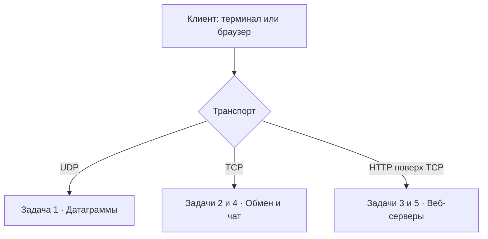

# Цель и архитектура

## Цель лабораторной работы

Изучить базовые механизмы сетевого программирования и протокол HTTP через последовательную реализацию пяти небольших приложений. Все программы написаны на Python 3 с использованием стандартных библиотек.

В ходе работы отрабатываются:

1. адресация по IP-адресу и порту, создание UDP- и TCP-сокетов;
2. обмен данными в модели «клиент–сервер»;
3. формирование HTTP-заголовков и передача HTML;
4. параллельное обслуживание нескольких TCP-клиентов;
5. получение данных HTML-формы, проверка ввода и формирование HTTP-ответов.

## Модель взаимодействия

UDP не устанавливает соединение и не гарантирует доставку. TCP обеспечивает надёжный упорядоченный поток байтов. HTTP определяет формат запросов и ответов, которые в рассматриваемых задачах передаются поверх TCP.

## Порты и точки входа

| Задание | Транспорт | Адрес сервера | Программа сервера |
|---|---|---|---|
| 1. UDP | UDP | `127.0.0.1:12345` | `task_1/server.py` |
| 2. Площадь | TCP | `127.0.0.1:12346` | `task_2/tcp_server.py` |
| 3. HTTP-страница | HTTP/TCP | `127.0.0.1:8080` | `task_3/http_server.py` |
| 4. Чат | TCP | `127.0.0.1:12347` | `task_4/chat_server.py` |
| 5. Оценки | HTTP/TCP | `127.0.0.1:8081` | `task_5/grades_server.py` |

!!! note "Почему 127.0.0.1?"
    Это адрес обратной петли (loopback). Подключиться к такому серверу можно с того же компьютера, но он не предназначен для доступа с других устройств сети.

## Используемые модули

| Библиотека | Назначение | Где используется |
|---|---|---|
| `socket` | Создание сокетов и сетевой обмен | Во всех заданиях |
| `threading` | Потоки и блокировка общего словаря | Задание 4 |
| `urllib.parse.parse_qs` | Разбор URL-кодированной HTML-формы | Задание 5 |
| `html.escape` | Экранирование пользовательского текста для HTML | Задание 5 |

Сторонние пакеты необходимы **только для генерации этого сайта MkDocs**; сами приложения на них не зависят.
