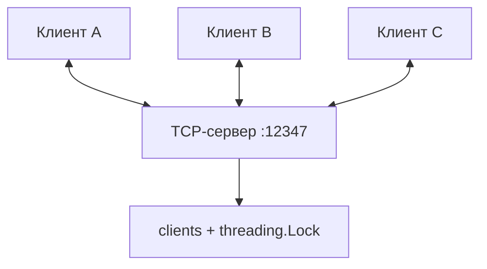

# 04 · Многопользовательский TCP-чат

`threading` · Порт `12347` · Несколько клиентов одновременно

## Постановка задачи

Реализовать чат, в котором несколько клиентов могут подключиться к одному серверу и отправлять сообщения другим участникам. Каждый клиент указывает имя при входе, а команда `/exit` завершает его сессию.

## Архитектура

Сервер принимает новые TCP-соединения в главном потоке. Для каждого клиента создаётся отдельный `threading.Thread`, который читает его сообщения. Общий словарь `clients` сопоставляет клиентские сокеты с именами, а `threading.Lock` защищает операции над словарём.



### Сценарий обмена

1. При подключении клиент передаёт своё имя с символом перевода строки.
2. Сервер регистрирует соединение и сообщает другим участникам о входе.
3. Клиент отправляет текст; сервер вызывает `broadcast()` и пересылает его **всем остальным** участникам.
4. Клиент читает входящие сообщения в отдельном фоновом потоке, поэтому может одновременно вводить новые.
5. При `/exit` либо разрыве соединения сервер удаляет клиента из общего словаря.

!!! tip "Почему используется `Lock`?"
    Несколько обработчиков изменяют общий словарь. Блокировка делает операции регистрации, удаления и копирования списка получателей согласованными. Сетевые отправки происходят уже после освобождения блокировки, поэтому медленный получатель не удерживает её во время `sendall()`.

## Исходный код

=== "Сервер · chat_server.py"

    ```python
    --8<-- "task_4/chat_server.py"
    ```

=== "Клиент · chat_client.py"

    ```python
    --8<-- "task_4/chat_client.py"
    ```

## Запуск

Откройте три терминала в каталоге `task_4`.

```bash
# Терминал 1
python3 chat_server.py
```

```bash
# Терминалы 2 и 3 — каждый в своём окне
python3 chat_client.py
```

Введите разные имена и отправьте сообщения. Проверьте, что сообщение клиента A появляется у B и наоборот. Командой `/exit` можно выйти из чата.

## Результат


<p class="result-caption">Рисунок 5. Два участника чата и журнал событий сервера.</p>

## Особенности и ограничения

- Каждому подключению соответствует отдельный поток сервера.
- Сообщения разделяются символом `\n`.
- Сервер не отправляет автору его собственное сообщение обратно.
- История сообщений не сохраняется, повторяющиеся имена не запрещены, аутентификации нет.
- `recv(1024)` у клиента может вернуть часть сообщения или сразу несколько; для надёжного построчного отображения в промышленном приложении потребовался бы буфер строк.

**Вывод:** в работе продемонстрировано одновременное обслуживание нескольких TCP-соединений и синхронизация общего состояния между потоками.
