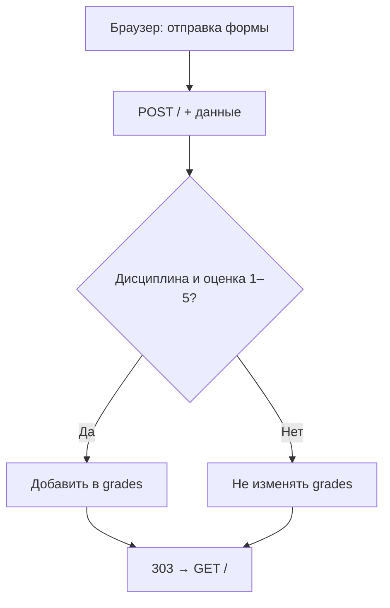

# 05 · Журнал оценок по HTTP

`GET /` · `POST /` · Порт `8081` · HTML-форма

## Постановка задачи

Реализовать веб-страницу журнала оценок, на которой можно видеть дисциплины и добавленные оценки, а также вводить новые оценки через HTML-форму. HTTP-запросы должны обрабатываться собственным TCP-сервером.

## Данные и маршрут

Программа хранит оценки в словаре `grades`, где ключ — название дисциплины, а значение — список целых чисел от 1 до 5.

```python
grades = {
    "Математика": [5, 4],
    "Русский язык": [5],
}
```

Этот фрагмент **иллюстрирует формат данных**, а не начальное содержимое словаря: в исходной программе `grades = {}`.

| Запрос | Действие сервера | Ответ |
|---|---|---|
| `GET /` | Генерация HTML-таблицы и формы | `200 OK`, HTML |
| `POST /` | Чтение формы, проверка и возможное добавление оценки | `303 See Other`, `Location: /` |
| Другой метод или путь | Отказ от обработки | `404 Not Found` |

## Обработка формы



1. Сервер считывает HTTP-заголовки до разделителя `\r\n\r\n`.
2. По `Content-Length` получает тело `POST` в полном объёме.
3. `parse_qs()` разбирает данные формы.
4. Пустое название дисциплины и оценки вне диапазона 1–5 не добавляются.
5. Ответ `303 See Other` перенаправляет браузер на `GET /`, чтобы обновить таблицу.
6. `html.escape()` экранирует название дисциплины перед подстановкой в HTML.

## Исходный код

```python
--8<-- "task_5/grades_server.py"
```

## Запуск и проверка

Из каталога `task_5`:

```bash
python3 grades_server.py
```

Откройте **[http://127.0.0.1:8081/](http://127.0.0.1:8081/)**. Введите дисциплину, выберите оценку от 1 до 5 и нажмите «Добавить». После отправки формы страница должна обновиться, показав новую запись.

Проверка через терминал (в отдельном окне):

```bash
curl -i http://127.0.0.1:8081/
curl -i -d "subject=Math&grade=5" http://127.0.0.1:8081/
curl -s http://127.0.0.1:8081/ | grep Math
```

Первая команда должна вернуть статус `200`, вторая — `303` с `Location: /`, третья — вывести строку таблицы с дисциплиной `Math`.

## Результат


<p class="result-caption">Рисунок 6. Интерфейс журнала оценок, отображаемый при GET-запросе.</p>

!!! info "Точность подтверждения"
    Скриншот фиксирует отображение страницы журнала (`GET`). Он сам по себе не является доказательством отправки конкретной формы `POST`; такой сценарий проверяется отдельно.

!!! warning "Ограничения"
    Данные хранятся **только в оперативной памяти** и исчезают после перезапуска. Сервер обрабатывает подключения последовательно, не ограничивает размер запроса и не рассчитан на публичное размещение в интернете. Эта реализация — учебный пример обработки HTTP, не промышленный веб-сервис.

**Вывод:** задача демонстрирует путь от HTML-формы до обработки HTTP-запроса, проверки данных, изменения состояния сервера и повторного отображения страницы.
