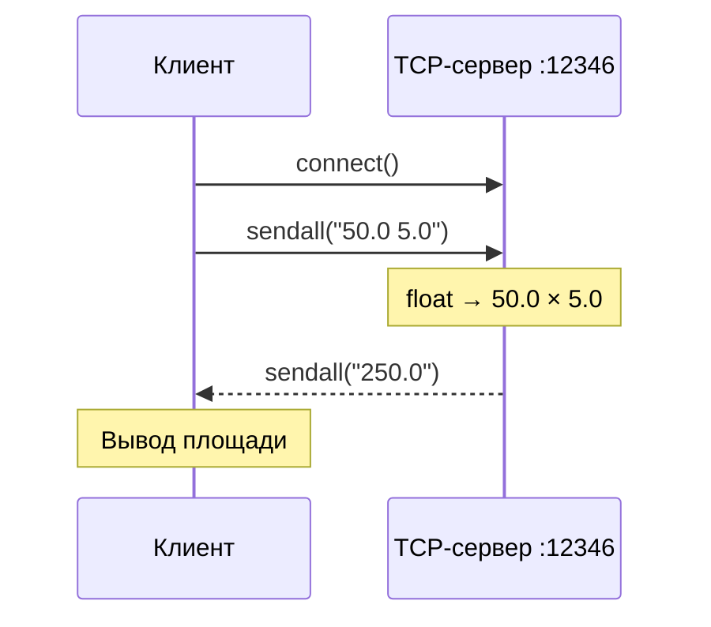

# 02 · Вычисление площади по TCP

`socket.SOCK_STREAM` · Порт `12346` · Вычисление на сервере

## Постановка задачи

Реализовать TCP-сервер, который получает от клиента основание параллелограмма `a` и высоту `h`, вычисляет площадь и передаёт её обратно.

Формула: **S = a · h**, где `a` — основание, `h` — соответствующая высота.

## Алгоритм

1. Сервер связывает сокет с `127.0.0.1:12346` и ждёт соединения с помощью `listen()` и `accept()`.
2. Клиент устанавливает TCP-соединение методом `connect()`.
3. Пользователь вводит два числа; клиент отправляет строку вида `50.0 5.0`.
4. Сервер преобразует значения в `float`, перемножает их и возвращает результат.
5. Клиент выводит полученное число.



## Исходный код

=== "Сервер · tcp_server.py"

    ```python
    --8<-- "task_2/tcp_server.py"
    ```

=== "Клиент · tcp_client.py"

    ```python
    --8<-- "task_2/tcp_client.py"
    ```

## Запуск и проверка

Запустите в разных терминалах из `task_2`:

```bash
python3 tcp_server.py
```

```bash
python3 tcp_client.py
```

Для контрольных значений:

| Основание `a` | Высота `h` | Ожидаемая площадь `S` |
|---:|---:|---:|
| 50 | 5 | 250 |
| 7.5 | 4 | 30 |
| 0 | 12 | 0 |

!!! warning "Границы учебной реализации"
    Сервер обрабатывает только **одно подключение**, затем завершает работу. Дополнительно не реализованы проверка корректности пользовательского ввода и собственное разделение сообщений: однократный `recv(1024)` рассчитан на маленькую демонстрационную передачу, а TCP в общем случае является потоком байтов.

## Результат


<p class="result-caption">Рисунок 2. Ввод значений в TCP-клиенте и получение площади с сервера.</p>

**Вывод:** TCP устанавливает соединение и позволяет передать данные в обе стороны. Для `a = 50` и `h = 5` получено `250.0`, что совпадает с математической проверкой.
