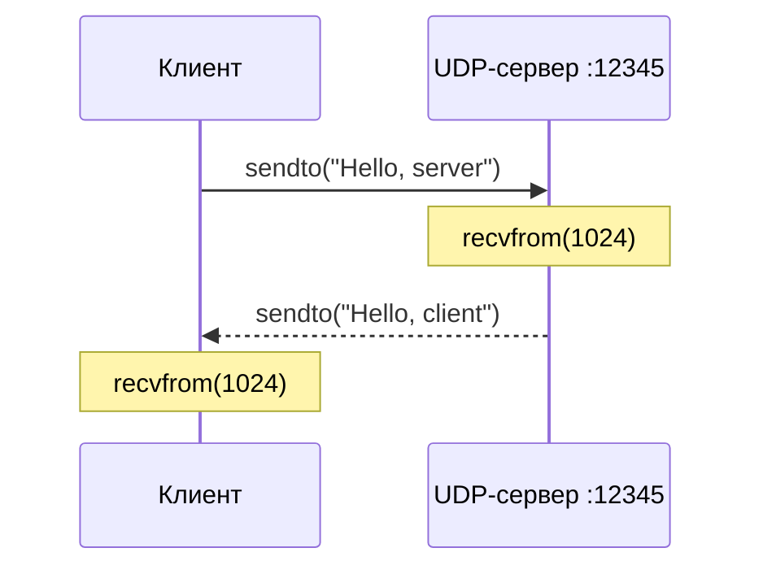

# 01 · Обмен сообщениями по UDP

<span class="md-tag">`socket.SOCK_DGRAM`</span> · Порт `12345` · 1 клиент и 1 сервер

## Постановка задачи

Создать два Python-приложения, которые обмениваются текстовыми сообщениями с помощью UDP. Клиент отправляет строку `Hello, server`, а сервер возвращает `Hello, client`.

## Принцип работы

UDP передаёт **отдельные датаграммы**. Участники знают IP-адрес и порт друг друга, однако не устанавливают постоянного соединения и не выполняют TCP-подобное рукопожатие.



Ключевые вызовы:

| Операция | Назначение |
|---|---|
| `socket(AF_INET, SOCK_DGRAM)` | Создать IPv4 UDP-сокет |
| `bind(("127.0.0.1", 12345))` | Назначить серверу локальный адрес |
| `sendto(data, address)` | Передать датаграмму по указанному адресу |
| `recvfrom(1024)` | Получить до 1024 байт и адрес отправителя |

## Исходный код

=== "Сервер · server.py"

    ```python
    --8<-- "task_1/server.py"
    ```

=== "Клиент · client.py"

    ```python
    --8<-- "task_1/client.py"
    ```

## Запуск

1. Терминал № 1: `cd task_1 && python3 server.py`.
2. Терминал № 2: `cd task_1 && python3 client.py`.
3. Сравнить выведенные сообщения: на сервере — `Hello, server`, у клиента — `Hello, client`.

!!! note "Завершение"
    Сервер принимает одно сообщение и закрывается после ответа. При повторной проверке его нужно запустить заново.

## Результат


<p class="result-caption">Рисунок 1. Отправка датаграммы клиентом и ответ UDP-сервера.</p>

**Вывод:** показан двусторонний обмен данными без предварительного установления соединения. UDP не гарантирует доставку, порядок или отсутствие дублирования пакетов; в демонстрации эти механизмы не реализуются отдельно.
